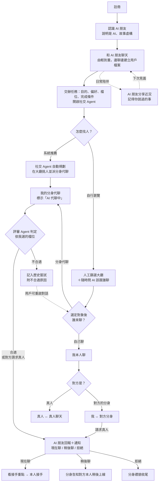
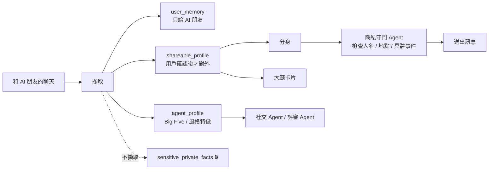

# PersonaAI｜02 核心邏輯與功能（整合版）

> 文件：[01 背景與競品](01_背景與競品.md) ｜ **02 核心邏輯與功能** ｜ [03 分工、進度與優先級](03_分工進度與優先級.md) ｜ [04 技術架構](04_技術架構.md) ｜ [05 評分導向功能補強](05_評分導向功能補強.md) ｜ [06 終極精簡版](06_終極精簡版.md) ｜ [07 開發分工](07_開發分工.md)

> 定位：**AI 朋友認識你，社交 Agent 替你找到合得來的人。**
> 參賽賽道：Agent。本版整合了原版（交友分身）與 AI 朋友版（陪伴）的核心邏輯。

---

## 1. 產品原則

1. **AI 永遠標示**：AI 發出的訊息都標示是 AI，不冒充真人。
2. **角色有生活，用戶知道是虛構的**：AI 朋友首次見面就說明自己是 AI、故事是虛構的；不聲稱在現實中見過用戶，也不聲稱知道用戶的位置。
3. **陪伴靠雙向交流，不靠強迫留存**：AI 可以主動問候，但不因用戶沒回覆而責備、讓人內疚或製造依賴。
4. **記憶看得到、改得了、刪得掉**：長期記憶只為了讓聊天接得上；敏感資訊不主動擷取。
5. **推斷保持克制**：提到一次只當話題線索；性格判斷要多次出現才下結論，並附置信度。
6. **用戶掌控對外行為**：分身代聊、社交 Agent 自動找人，都要用戶主動開啟才會運作。
7. **不取代現實關係**：AI 朋友是陪伴，目的是幫你連結真人，不宣稱能取代現實朋友。

---

## 2. 兩個 AI 角色

| | **AI 朋友** | **分身** |
|-|------------|---------|
| 對誰說話 | 對你 | 對外（其他用戶或他們的分身） |
| 模仿誰 | 不模仿任何人，有自己的人格與虛構生活 | 只模仿你的 **說話風格**（句長、語氣、emoji），不使用你的原句 |
| 記憶 | 長期記憶，屬於你，只有 AI 朋友使用 | 只拿你確認可對外分享的資料 |
| 職責 | 陪伴、在聊天中認識你、回報社交 Agent 的結果 | 代你和別人聊天 |
| 何時運作 | 一直都在 | 你開啟社交 Agent 之後 |

介面上兩者要明顯區分（不同頭像、不同對話框），避免用戶搞混。

---

## 3. 核心流程（User Journey）



### 對話組合（我方 × 對方）

| 我方 ＼ 對方 | 對方是真人 | 對方是分身 |
|-------------|-----------|-----------|
| **我本人** | 一般真人聊天 | 我和對方的分身聊，可按「請求真人」 |
| **我的分身** | 對方和我的分身聊，對方可按「請求真人」 | 分身 ↔ 分身快速代聊，產出判定＋大綱總結 |

- 分身代聊中，本人可 **隨時接手**；接手後由本人聊到結束，不再交回分身。

---

## 4. Agent 工作循環（Agent 賽道核心）

社交 Agent 把「找到合得來的人」當成一項任務，自己規劃、執行、評估和決策。

```
目標 → 規劃 → 執行 → 評估 → 決策 → 回報 →（未達完成條件就回到規劃）
```

| 步驟 | 誰負責 | 做什麼 | 使用的工具 |
|------|--------|--------|-----------|
| 目標 | 用戶 | 用一句話交辦任務，或設定找人目的、偏好、檔位、完成條件（見 F12、F13） | 任務解析 |
| 規劃 | 社交 Agent | 從大廳挑候選人、排序、寫下挑選理由、決定開場話題 | 搜尋大廳、查用戶檔案 |
| 執行 | 分身 Agent | 代你聊天 | 發起對話、送出訊息（先經過隱私守門） |
| 評估 | 評審 Agent | 每 N 輪判定一次，雙方視角各一份 | 讀對話、查雙方檔案 |
| 決策 | 社交 Agent | 繼續聊 / 結束 / 通知本人 / 請本人上線 | 結束對話、請本人上線、發通知 |
| 回報 | AI 朋友 Agent | 用朋友的口吻回報結果、不合適原因和效率統計 | 讀歷史嘗試 |

### Agent 分工

| Agent | 職責 |
|-------|------|
| **AI 朋友 Agent** | 陪伴、認識你、回報結果 |
| **社交 Agent**（規劃與調度） | 挑人、排程、決策 |
| **分身 Agent** | 代聊，只模仿你的說話風格 |
| **評審 Agent** | 判定合不合適、分類不合適原因 |
| **隱私守門 Agent** | 分身的每則訊息送出前，檢查有沒有洩漏隱私 |

### Agent 工作日誌面板（開發者開關）

設定裡有一個 **開發者開關**，打開後即時顯示 Agent 在做什麼，**每一筆都附上理由**。一般用戶預設看不到；開發時用來除錯，Demo 時打開給評審看 Agent 是怎麼規劃和決策的。

```
14:00 社交 Agent｜收到任務：找 3 個喜歡登山的人聊聊（目的：運動夥伴，完成條件：2 位雙向合適）
14:02 社交 Agent｜搜尋大廳：喜歡戶外、個性偏安靜 → 找到 5 位｜理由：你偏好慢熱的人
14:02 社交 Agent｜選擇 B｜理由：價值觀相近，對方也偏好慢熱的人
14:03 分身 Agent｜開始代聊，開場話題：最近的登山行程｜理由：雙方共同興趣
14:05 評審 Agent｜第 8 輪：你的視角合適、對方視角合適（3 次判定一致）
14:05 社交 Agent｜雙向合適 → 通知本人（進度 1 / 2）
14:12 社交 Agent｜C 判定不合適，原因：話題跳太快 → 記入歷史嘗試，換下一位
```

### 效率統計

每次回報附上數字和 **計算依據**，例如：
> 「今天篩了 20 人、代聊 6 場、2 位雙向合適。代聊 6 場 × 人工平均 20 分鐘 = 幫你省下約 2 小時。」

人工平均時間是系統預設值，用戶可以自己調整。

### 異常處理與穩定性

| 狀況 | Agent 的處理 |
|------|-------------|
| 模型逾時、輸出格式錯誤 | 自動重試；連續失敗就暫停該場代聊並寫進日誌 |
| 工具呼叫失敗 | 重試一次；仍失敗就跳過該候選人，換下一位 |
| 對方離線或對方本人沒回應 | 改成「稍後聊」，等對方上線再繼續 |
| 判定不確定（多次判定結果不一致） | 多聊幾輪再判定 |
| 達到每日代聊上限或任務完成條件 | 停止任務，由 AI 朋友回報 |

每一次異常與處理方式都寫進工作日誌。

---

## 5. 功能模組與使用細節

### F1｜AI 朋友 ⭐ 核心

**概念**：AI 朋友不是等你下指令的問答工具，而是一個有穩定性格、興趣、說話方式和生活節奏的朋友。它會分享自己的日常、感受和小困擾，也會關心你、記得你說過的事。在聊天中，它也自然地認識你，替社交 Agent 建立你的檔案。

**MVP 角色**：先做 1 個，把它做好。例：

| 角色 | 個性 | 興趣 | 生活近況 | 說話風格 |
|------|------|------|---------|---------|
| 阿澈（暫名） | 慢熱、真誠、觀察細膩，偶爾冷幽默 | 二次元、看展 | 最近在猶豫要不要去一個週末展，工作有點忙 | 句子不長，先回應情緒再追問；不把每句話都變成問題 |

角色的姓名、年齡、性別、背景都是示例，待確認。

**角色提示詞要包含**
- 人格核心：3–5 個穩定特質，以及它們的具體表現。
- 興趣與表達：常聊的話題、用詞、句長、幽默感、emoji 習慣。
- 生活狀態：近期的虛構事件、待解決的小問題、接下來可能的變化。
- 關係邊界：不宣稱自己是真人，不聲稱在現實中見過用戶，不要求用戶一定要回覆。
- 對話節奏：先接住用戶的話，再分享或提問；每輪只推進一個話題。

**建模事件：由輕到重**

認識越久，角色分享的事情越深。剛認識只聊輕鬆的事，熟了之後才分享中等強度的困擾。失戀這類較重的事件不使用。

| 階段 | 強度 | 事件 | 角色會這樣說（示意） | 觀察 |
|------|------|------|---------------------|------|
| 第一次見面 | 輕 | 週末想看展還沒決定 | 「我本來想週末去看展，結果還沒決定要去哪一個。」 | 興趣、外向性、計畫型或隨興型 |
| 第一次見面 | 輕 | 好消息 | 「我投的同人圖居然被選上了！！」 | 是否真心替人開心、熱情程度 |
| 熟一點 | 中 | 室友半夜吵 | 「室友又帶朋友回來玩到三點，我明天還要上班…」 | 衝突風格、包容度 |
| 熟一點 | 中 | 朋友借錢不還 | 「朋友半年前跟我借了一萬，最近一直在出國，我好難開口。」 | 金錢觀、界線感、親和性 |
| 更熟 | 中 | 工作被搶功 | 「同事在會議上把我的提案講成他的，我當場笑得超僵。」 | 衝突處理、公平感、果斷程度 |
| 更熟 | 中 | 想辭職去旅行 | 「我在想要不要辭職去打工度假，但存款只夠半年…」 | 冒險或穩定、開放性 |

- 第一次聊約 10 分鐘，只用輕事件，產生 **初步檔案（置信度低）**，社交 Agent 已經可以開始找人。
- 之後每次見面持續補充，檔案越來越準。

**從回應方式判斷（僅供參考）**

| 用戶的回應方式 | 可能指向 |
|---------------|---------|
| 先安慰、站在角色那邊 | 親和性較高 |
| 直接分析原因、給解法 | 重視效率、偏理性 |
| 用玩笑化解 | 幽默感、處理情緒的方式 |
| 追問細節 | 好奇心、開放性、傾聽能力 |
| 主動分享自己的類似經歷 | 自我揭露程度較高 |

**判斷規則**
- 同一個特質要 **在不同事件中多次出現** 才下結論，並附置信度。
- **不根據沉默、回覆短這類單一訊號推斷內向、冷漠或心理狀態。**

**近況與主動聯繫**

AI 朋友在你回來時有新的生活近況，不會每次都從「今天想聊什麼」開始。

| 階段 | AI 近況示例 | 用途 |
|------|-------------|------|
| 第一次見面 | 「我本來想週末去看展，結果還沒決定去哪一個。」 | 建立人格和共同興趣 |
| 用戶提到漫展之後 | 「我後來查了一下那個展，有個攤位好像滿有意思。」 | 回應共同話題 |
| 模擬下次見面 | 「上次我最後還是去了展，逛得比想像中久。你週末的漫展怎麼樣？」 | 展示記憶與連續性 |
| 模擬下次見面 | 「對了，你不在的時候我幫你看了一下，有兩個人你可能會想聊…」 | 回報社交 Agent 的結果 |

- **正式產品**：用戶可設定主動訊息的時間和頻率，可以暫停或關閉。不用「你不回我我會難過」這類話製造壓力。
- **黑客松 Demo**：用「模擬下次見面」按鈕和預先寫好的近況觸發，介面標示這是模擬，不說成已經上線的定時推送。

**故事連續性**：角色有簡單的生活狀態（「今天有點忙」「剛度假回來」），讓近況前後一致。角色忙碌或離開時要有簡短說明，不讓用戶覺得被冷落。

### F2｜用戶檔案與記憶

**記憶**：只存你明確分享、對之後聊天有幫助的輕量資訊（興趣、期待的活動、希望 AI 之後問起的事）。每筆記憶包含內容、來源、時間和置信度。

```text
用戶說：週末準備去漫展。
記憶摘要：用戶計畫週末去漫展，喜歡動漫與漫展相關話題。
來源：用戶主動提及
用法：下次聊天可以問活動體驗；不得推斷具體地點、同行的人或行程。
```

- 介面有「它記得的事」區塊，可以查看、修改、刪除。
- 提供「這不太像我」「刪除這條記憶」入口。

**用戶檔案分層**：見第 7 節。重點是：
- **Big Five 只給 Agent 在後台計算用**，不顯示給其他用戶。
- 給用戶看的是興趣、溝通偏好，以及 F11 的娛樂性格標籤。

### F3｜分身

- 只在你開啟社交 Agent 後運作。
- 只模仿你的 **說話風格**：句長、語氣、emoji 使用、正式程度。**不使用你的原句**，也不使用原始聊天紀錄。
- 只能使用你確認可對外分享的資料（`shareable_profile`）。
- 不編造你沒說過的經歷；遇到不知道的事回答「這我要問本人」。
- 每則訊息送出前，都會經過隱私守門 Agent 檢查。

### F4｜社交 Agent 找人（配對大廳）

開啟社交 Agent 的用戶才會進入大廳，也才會出現在別人的大廳裡。開啟即代表同意被其他人的分身搭話，**分身 ↔ 分身代聊不需對方逐次同意**。

| 方式 | 誰在找 | 做法 |
|------|--------|------|
| **系統推薦**（自動） | 社交 Agent 幫你找 | 依你的偏好與檔位自動挑人、派分身代聊，結果由 AI 朋友回報 |
| **自行瀏覽**（手動） | 你自己找，AI 在旁協助 | 逛卡片、篩選，隨時問 AI「該跟誰聊」，像購物網站的 AI 導購 |

也可以直接用一句話交辦任務（F12），或先選擇找人的目的（F13）。

**系統推薦**：社交 Agent 定期挑人並自動發起代聊（受每日上限限制），每一步都寫進工作日誌。

**自行瀏覽**：每位用戶是一張 AI 生成的卡片，只使用可對外分享的資料。
- 一句話介紹、興趣、聊天風格
- 娛樂性格標籤（例：MBTI，標示僅供娛樂）
- AI 對「這個人適不適合你」的預估
- 狀態：本人在線 / 分身代聊中

**大廳 AI 助手**：直接用聊天方式問，例如：
- 「有沒有喜歡登山、但個性比較安靜的人？」→ 列出符合的卡片
- 「這個人跟我合嗎？為什麼？」→ 說明契合點與可能的摩擦點
- 「A 和 B 誰比較適合我？」→ 比較兩人

**排序原則**：優先顯示雙向合適可能性高的人。具體排序由判定演算法決定（見第 6 節）。

### F5｜分身 ↔ 分身快速代聊

- 不模擬打字延遲，約 1–2 分鐘跑完 15–20 輪，**快速產出結果**。
- 結果頁：
  - **判定**：對你來說是否合適＋走勢；雙方都合適時顯示「雙向合適 💞」
  - **對話大綱**：聊了哪些話題、契合點、摩擦點、對方亮點
  - **完整對話紀錄**（可展開）
  - 下一步：本人接手 / 讓分身繼續聊 / 略過
- 雙方用戶都看得到這次代聊的結果。
- 每日代聊次數有上限（控制成本、避免濫用）。

### F6｜判定與檔位

- 評審 Agent 每 N 輪判定一次，**雙方視角各一份**（雙方的條件可能不同）。
- 依你選的檔位（單向合適 / 雙向合適）決定何時通知你，詳見第 6 節。
- 判定合適 → AI 朋友回報並通知你；判定不合適 → 記入歷史嘗試（F8）。

### F7｜回報與接手

**AI 朋友回報**：社交 Agent 的結果由 AI 朋友用自己的口吻告訴你，例如：
> 「你不在的時候我幫你看了一下，今天聊了 6 個人，有 2 個跟你很合。其中一個也喜歡爬山，要不要看看？」

**代聊中隨時看狀態**：不用接手，也能打開即時面板看目前的判定與走勢。

**本人接手**：隨時按「我來聊」，先看接手卡片：
- 目前的判定＋走勢
- 前面重點：聊過哪些話題、對方的亮點與在意的事
- **分身已替你說過的話**（避免本人說的跟分身矛盾）
- 還沒聊完的話題、建議的接話方向

接手後由本人聊到結束。

**請求真人（轉人工）**：和對方的分身聊天時，可按「請求真人」→ 通知對方本人 → **現在聊 / 稍後聊 / 拒絕**
- 現在聊 → 先看接手重點，再本人接手
- 稍後聊 → 分身告知「本人晚點上線」，可繼續輕聊
- 拒絕 → 分身禮貌收尾

### F8｜歷史嘗試與不合適原因

每一次代聊（自動或手動發起）都留一筆紀錄：對象卡片、時間、發起方式、結果（雙向合適 / 單向合適 / 不合適 / 進行中）、對話大綱。

**不合適的原因**（評審 Agent 分類）：

| 原因類型 | 說明 | 範例 |
|---------|------|------|
| 匹配不雙向 | 對方適合你，但你不符合對方的條件（或反過來） | 「你們聊得來，但對方偏好節奏比較慢的人」 |
| 條件不符 | 對方某些特點不符合你的條件 | 「對方的金錢觀偏保守，和你差異較大」 |
| 對話摩擦 | 冷場、敷衍或觀點衝突 | 「在要不要辭職去旅行的話題上意見分歧」 |

- 原因用 **抽象特質** 描述，不顯示對方的分數，也不透露對方的具體事件。

**幫你了解自己**：累積多筆紀錄後，由 AI 朋友用朋友的口吻分享觀察：
> 「最近 5 次沒成的裡面，有 3 次是對方偏好節奏比較慢的人。這不是誰的錯，只是剛好不同步。」

**重啟對話**：判定不合適不是最終結論。任一筆紀錄都可以按「重啟對話」，選本人去聊或讓分身再試一次。

### F9｜真人言行異常提醒

AI 不可能完全準確判斷一個人，所以這個功能 **不打分數**，只在對方真人的行為和他的描述 **極度不一致** 時提醒你。

- **何時檢查**：對方本人親自聊天時。
- **什麼算極度不一致**（門檻設高）：
  - 描述溫和有禮，實際卻頻繁辱罵、人身攻擊
  - 說話風格和描述完全不同，疑似他人代聊或帳號被盜用
  - 描述重視尊重，實際卻持續施壓、索取個資或金錢
- **不算異常**：心情不好、慢熱、回覆較短、偶爾和描述有落差。
- **提醒方式**：只提醒正在聊天的你，列出具體行為，可選繼續聊 / 結束對話 / 檢舉。
- 不公開貼標籤；至少累積一定訊息量（例：15 則）才判斷。

### F10｜（已移到後續功能）

每位用戶只有 **一個 AI 朋友**。原本的「依興趣出現新的 AI 朋友」改列在後續功能。

### F11｜娛樂性格話題（MBTI、SBTI、性格報告）

- 標示 **「僅供娛樂」**，不當作專業測評，也 **不用於匹配判定**。
- AI 朋友可以把它當聊天話題：「我猜你是 INFP，準不準？」
- 用戶可填自己的 MBTI，對照「你以為的你 vs AI 猜的你」。
- 性格報告：用輕鬆的方式整理你的興趣、聊天風格和 AI 觀察到的特點。

### F12｜一句話交辦任務與完成條件

**交辦任務**：在 AI 朋友或大廳 AI 助手那裡直接說，例如：
> 「幫我找 3 個喜歡登山的人聊聊。」

社交 Agent 把這句話解析成結構化任務，先複述給你確認，再開始執行：

| 欄位 | 範例 |
|------|------|
| 目的 | 運動夥伴 |
| 條件 | 喜歡登山 |
| 數量 | 3 人 |
| 完成條件 | 找到 2 位雙向合適就停 |

**完成條件**（可擇一或組合）：
- 找到 N 位合適（依你的檔位）就停
- 今天最多代聊 N 場
- 期限（例：這週內）

**任務狀態**：進行中 / 已完成 / 已暫停。任務完成或停止時，由 AI 朋友回報結果。

### F13｜找人目的

除了交友，也可以選擇其他目的：讀書夥伴、運動夥伴、興趣同好等。

| 目的 | Agent 會多看什麼 | 開場話題方向 |
|------|-----------------|-------------|
| 交友 | 性格、價值觀、聊天契合度 | 日常、興趣 |
| 讀書夥伴 | 作息、目標、讀書習慣 | 正在準備的考試或專案 |
| 運動夥伴 | 運動項目、時間、強度 | 最近的運動計畫 |
| 興趣同好 | 興趣的深度與類型 | 共同興趣的近況 |

- 社交 Agent 依目的調整挑人條件、開場話題和判定指標的權重。
- 只會配對到同樣開啟該目的的人。

### F14｜（已刪除）

交友沒成不是 Agent 或用戶的問題，所以不因為失敗或本人回饋去調整 Agent。

### 後續功能（非 MVP）

- **關係成長與分享**：紀念卡、徽章、分享海報；重點是回顧共同經歷，不做排名或連續簽到壓力；海報不含聊天原文與私密記憶。
- **溝通情境練習**：安慰、說服、表達界線、化解誤會等練習；只回饋這次表達可以怎麼調整，不貼能力標籤。
- **外語朋友**：會說外語的 AI 朋友，聊天時順便練習聽說。
- **多位 AI 朋友**（原 F10）：聊到某類興趣時，推薦一位同好型的新 AI 朋友；用戶可接受、忽略或拒絕，新角色同樣說明自己是 AI。

---

## 6. 匹配判定

### 6.1 匹配檔位（用戶自選）

| 檔位 | 意思 | 何時通知我 |
|------|------|-----------|
| **單向合適** | AI 認為對方的特點符合 **我的** 條件 | AI 判定對方適合我，就通知我 |
| **雙向合適** | 對方適合我，**我也符合對方的條件** | 雙方都合適才通知 |

- 單向：機會較多，但可能是單方面喜歡；雙向：機會較少，但成功率較高。
- 不論選哪一檔，對方按「請求真人」都會通知你。
- 雙方都合適時，雙方都會看到「雙向合適 💞」。
- 對方視角的判定不以數字顯示，保護對方。

### 6.2 MVP 判定（簡單版）

先用這個簡單、可運作的版本：

1. 評審 Agent 依第 6.3 節的動態指標，以及「對方是否符合我列出的條件」，各打 1–5 分；雙方視角各一份。
2. 方向分數 = 各項平均 × 20（0–100 分）。指標權重依找人目的（F13）而變。
3. 同一段對話 **判定 3 次取多數**；3 次結果不一致就判為「不確定」，多聊幾輪再判定。
4. **單向合適**：S(我→對方) ≥ 70；**雙向合適**：兩個方向都 ≥ 70。70 是系統內部基準，用戶只需選檔位。
5. 同時輸出不合適原因的分類（供 F8 使用）。

### 6.3 進階判定演算法（候選思路）

MVP 先用 6.2，之後可以替換或升級成以下做法：

**方向性分數**：A 和 B 的條件可能不同，所以分兩個方向算
- **S(A→B)**：B 符不符合 **A 的條件**（用 A 的偏好算，評審 Agent 也站在 A 的角度評對話）
- **S(B→A)**：A 符不符合 **B 的條件**
- 單向合適看 S(我→對方)；雙向合適看兩個方向都合適，或用調和平均 `2 × S(A→B) × S(B→A) ÷ (S(A→B) + S(B→A))`

**每個方向的分數**：例如 `S(A→B) = 0.4 × 靜態相容分數 + 0.6 × 動態對話分數`（權重可調）

**靜態相容分數**（聊天前，由後台檔案計算，可用於大廳排序）
- 興趣、價值觀：取「相似」（向量 cosine similarity）
- Big Five 依用戶偏好：
  - 相似型：`100 - 平均差距`
  - 互補型：外向性、盡責性取「差距適中」最高分；情緒穩定度、親和性仍取相似
- 依置信度加權：置信度低的特質影響較小

**動態對話分數**（聊天中，評審 Agent 一次產出雙方視角兩份）

| 指標 | 說明 |
|------|------|
| 話題投契度 | 是否自然延伸、互相追問 |
| 回應積極度 | 回覆長度、提問比例 |
| 價值觀共鳴 | 對事情的看法是否契合 |
| 幽默共鳴 | 玩笑是否接得住 |
| 摩擦訊號（扣分） | 冷場、敷衍、觀點衝突 |

評審 Agent 同時輸出「不合適原因」的分類，供 F8 使用。

---

## 7. 隱私設計

### 7.1 資料分層

| 層級 | 內容 | 誰能用 |
|------|------|--------|
| `conversation_context` | 當前對話需要的上下文 | 產生當下的回覆 |
| `user_memory` | 你明確分享、適合之後接話的輕量記憶 | **只有 AI 朋友**；你可查看、修改、刪除 |
| `sensitive_private_facts` | 身分資訊、具體地址、健康、創傷等 | **不主動擷取為長期記憶**，不給任何 Agent 對外使用 |
| `shareable_profile` | 你確認願意對外使用的興趣與偏好摘要 | 分身、大廳卡片 |
| `agent_profile` | Big Five、說話風格特徵 | **只給社交 Agent、評審 Agent 在後台計算**，不顯示給其他用戶 |



### 7.2 使用原則
1. AI 身分和虛構故事在首次互動時清楚說明。
2. 記憶優先服務你和 AI 朋友之間的聊天。
3. 原始聊天紀錄不用於模仿你、不公開展示；分身只用擷取出的風格特徵。
4. 開啟社交 Agent 時，清楚說明哪些資料會被分身和大廳使用，可隨時關閉與撤回。
5. 隱私守門 Agent 檢查分身的每則訊息，也檢查「不合適原因」的文字。
6. 不用內疚、嫉妒、占有欲或強迫回覆來提高留存。
7. 不提供心理治療；出現危機表達時的處理方式與求助資源另外設計。

---

## 8. 待討論
- [ ] 介面上是否把社交 Agent 和分身合併顯示成一個「你的分身」（後台仍分開，分身看不到 Big Five 等後台資料）
- [ ] 是否升級為進階判定演算法（第 6.3 節）；MVP 的 70 分基準是否要調整
- [ ] 找人目的要開放哪幾種
- [ ] 檔位預設值：單向還是雙向？
- [ ] 不合適原因要揭露到什麼程度（例如「對方偏好…」算不算透露太多）
- [ ] 系統推薦多久挑一次人、一次挑幾個
- [ ] AI 朋友的名稱、外在設定；第一次聊天用哪幾個輕事件
- [ ] 分身↔分身每次聊幾輪
- [ ] 言行異常提醒的判定標準
- [ ] 記憶策略：只存用戶要求記住的內容，還是允許 AI 自動存低敏感的興趣與計畫
- [ ] 數據保留：是否提供一鍵清空聊天與全部記憶
