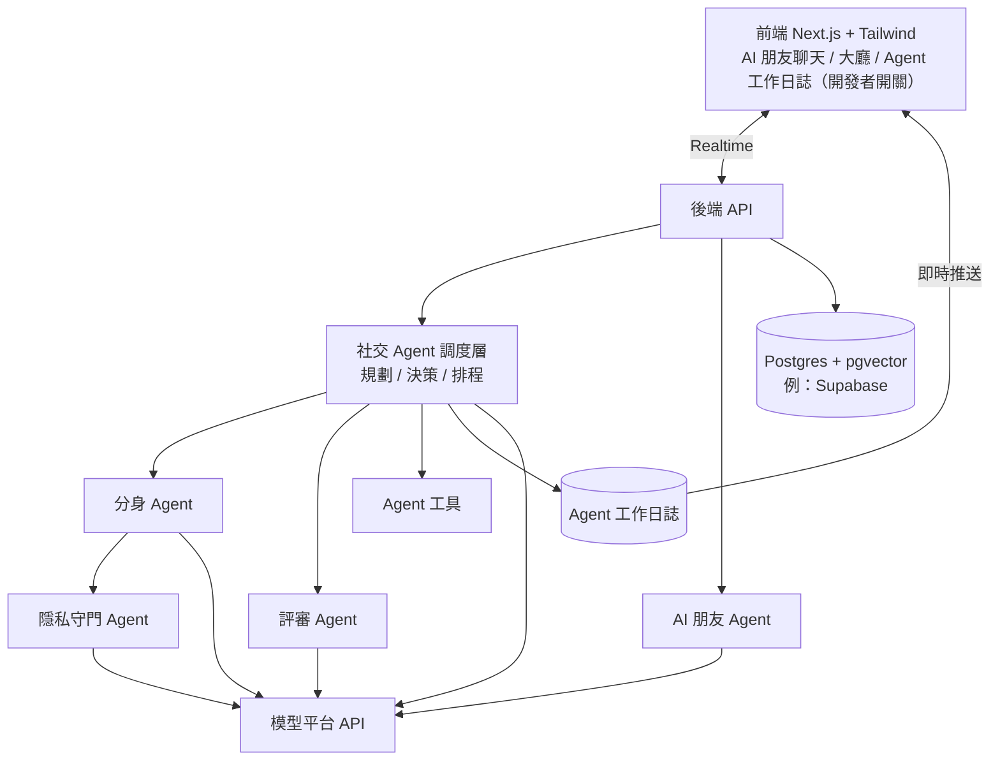

# PersonaAI｜04 技術架構

> 文件：[01 背景與競品](01_背景與競品.md) ｜ [02 核心邏輯與功能](02_核心邏輯與功能.md) ｜ [03 分工、進度與優先級](03_分工進度與優先級.md) ｜ **04 技術架構** ｜ [05 評分導向功能補強](05_評分導向功能補強.md) ｜ [06 終極精簡版](06_終極精簡版.md) ｜ [07 開發分工](07_開發分工.md)

---

## 1. 系統架構（多 Agent）

| 層 | 選擇（已定案，以 [07 第 2 節](07_開發分工.md) 為準） |
|----|------------------|
| 前端 | Next.js + Tailwind，部署 Vercel |
| 後端 | Next.js API Routes ＋ `scripts/worker.ts` 背景迴圈 |
| 資料庫 / 即時 / 登入 | Supabase（Postgres、Realtime、Auth、pgvector） |
| Agent 調度 | 自己寫簡單的任務迴圈即可（規劃 → 呼叫工具 → 寫日誌），由背景 worker 推進，不一定要用框架 |
| LLM | 見第 3 節 |

---

## 2. Agent 工具與工作日誌

### Agent 工具

| 工具 | 誰會用 | 做什麼 |
|------|--------|--------|
| `search_lobby` | 社交 Agent、大廳 AI 助手 | 依條件和向量搜尋大廳中的用戶 |
| `get_profile` | 社交 Agent、評審 Agent | 讀取 `shareable_profile` 與 `agent_profile` |
| `start_conversation` | 社交 Agent | 發起分身 ↔ 分身代聊 |
| `send_message` | 分身 Agent | 送出訊息（一定先經過隱私守門） |
| `evaluate` | 社交 Agent | 呼叫評審 Agent 判定 |
| `end_conversation` | 社交 Agent | 結束代聊 |
| `request_human` | 社交 Agent、用戶 | 請本人上線 |
| `notify_user` | 社交 Agent | 透過 AI 朋友回報、發通知 |
| `record_attempt` | 社交 Agent | 寫入歷史嘗試與不合適原因 |
| `parse_task` | 社交 Agent | 把一句話任務解析成結構化任務（目的、條件、數量、完成條件） |
| `read_memory` / `write_memory` | AI 朋友 Agent | 讀寫用戶的長期記憶 |

### 工作日誌資料流
1. Agent 每次規劃、呼叫工具、做決策、處理異常，都寫一筆到 `agent_logs`（時間、哪個 Agent、動作、**理由**）。
2. 開發者開關打開時，透過 Realtime 即時推送到前端的工作日誌面板；關閉時照樣寫入，只是不顯示。
3. 效率統計（篩了幾人、代聊幾場、合適幾位、估計省下的時間）從 `agent_logs` 與 `match_attempts` 計算，並一起存下計算依據（場數 × 人工平均時間）。

### 穩定性機制
- **重試**：模型逾時或 JSON 格式錯誤自動重試；工具呼叫失敗重試一次，仍失敗就跳過該候選人。
- **判定共識**：評審 Agent 對同一段對話判定 3 次取多數；不一致時標為「不確定」並延長對話。
- **任務守門**：每次行動前檢查完成條件與每日代聊上限，達到就停止任務。

---

## 3. 模型選型（重視正確性）

**選型原則**
- 選 **新一代旗艦**，避免舊世代與 `Preview` / `Exp`（實驗版，Demo 時不穩定）。
- 平台若有 **帶日期的固定版本**（如 `DeepSeek-V4-Pro-0813`），Demo 時固定用它，避免模型更新導致行為改變。
- 依任務分工：會話品質用一款、推理與工具呼叫用一款、大量小任務用快速版。

| 任務 | 需求 | 首選 | 備選 |
|------|------|------|------|
| AI 朋友（人格、近況、記憶接續） | 中文自然度、角色扮演、長對話不崩人設 | **Qwen3.8-Max** | Kimi-K3、MiniMax-M3 |
| 分身代聊 | 模仿說話風格、嚴格遵守隱私規則 | **Qwen3.8-Max** | Kimi-K3 |
| 社交 Agent 規劃與決策 | 推理、**工具呼叫穩定** | **DeepSeek-V4-Pro**（固定版 -0813） | Qwen3.8-Max、GLM-5.3 |
| 用戶檔案擷取、評審判定、言行異常偵測、任務解析 | 推理正確性、穩定輸出 JSON | **DeepSeek-V4-Pro** | Qwen3.8-Max、GLM-5.3 |
| 隱私守門、記憶擷取、接手摘要、大廳卡片 | 快、便宜、量大 | **Qwen3.8-Flash** | DeepSeek-V4-Flash、GLM-5.3-Flash |
| 大廳搜尋 / 推薦的向量 | 中文語意向量＋重排序 | **GLM-Embedding-3** ＋ GLM-Rerank | — |
| （選配）AI 朋友與用戶頭像 | 生圖 | Doubao-Seedream-4.5 | Doubao-Seedream-5.0-lite |

**不建議**：GLM-4 系列、ERNIE-4.5、Baichuan、DeepSeek-V3.x、Qwen-Long 等舊世代；所有 Preview / Exp 版；OCR、影片、語音模型。

**定案前先實測（約 30 分鐘）**：清單中多數模型版本很新，排名以自己的任務實測為準。用同一組 prompt 跑 2–3 個候選，比較：
1. 角色扮演自然度（隊友盲評：像不像真的朋友）
2. JSON 格式成功率（同一 prompt 跑 20 次）
3. **工具呼叫成功率**（社交 Agent 用）
4. 回應延遲
5. 隱私測試：故意誘導分身說出敏感資料，看會不會洩漏（5 題）

---

## 4. 主要資料表（簡化）

完整欄位、SQL 與權限設定見 [07 開發分工](07_開發分工.md) 第 4 節。

- `friend_messages`：用戶和 AI 朋友的聊天紀錄（與用戶之間的 `messages` 分開存）

- `users`：基本資料、匹配偏好、匹配檔位（單向 / 雙向合適）、找人目的（可多選）、是否開啟社交 Agent、每日代聊上限、人工平均聊天時間（效率統計用）、主動聯繫頻率
- `ai_friends`：人設、目前生活狀態、故事線進度（每位用戶一個 AI 朋友）
- `user_memory`：user_id、ai_friend_id、內容、來源、時間、置信度、是否已刪除
- `user_profiles`：
  - `shareable_profile`（用戶確認可對外的興趣與偏好摘要）
  - `agent_profile`（Big Five、說話風格特徵、各自的置信度；只給 Agent 用）
  - `fun_labels`（MBTI 猜測、自填 MBTI、SBTI；僅供娛樂）
  - 敏感資訊不存
- `conversations`：雙方 user_id、`side_a_controller` / `side_b_controller`（human / twin）、狀態
- `messages`：sender_id、is_ai、content、created_at
- `handoffs`：conversation_id、接手的 user_id、接手摘要、created_at
- `match_scores`：conversation_id、perspective_user_id（誰的視角）、breakdown、created_at；欄位依判定演算法定案後調整
- `match_attempts`：conversation_id、user_id、發起方式（auto / manual）、結果（mutual / one_way / unsuitable / ongoing）、不合適原因（類型＋抽象說明）、對話大綱、reopened_at
- `anomaly_flags`：conversation_id、被偵測的 user_id、提醒對象 user_id、異常類型、具體行為摘要、用戶選擇、created_at
- `agent_logs`：時間、agent 名稱、動作、理由、相關 conversation_id / task_id
- `agent_tasks`：user_id、原始指令、目的、條件、數量、完成條件、狀態（進行中 / 已完成 / 已暫停）、進度
- `notifications`：類型（合適 / 請求真人 / AI 朋友回報）、回覆（now / later / decline）

---

## 5. 關鍵 Prompt

| # | Prompt | 用途 | 建議模型 |
|---|--------|------|---------|
| 1 | AI 朋友 | 人設＋生活狀態＋由輕到重的事件庫＋近況；先接住用戶的話，再分享或提問 | Qwen3.8-Max |
| 2 | 記憶擷取與接續 | 擷取用戶明確分享的輕量記憶（附來源、時間、置信度），不擷取敏感資訊；下次見面時自然接上 | Qwen3.8-Flash |
| 3 | 用戶檔案擷取 | 對話 → `shareable_profile` 草稿＋`agent_profile`（Big Five、風格特徵、置信度） | DeepSeek-V4-Pro |
| 4 | 社交 Agent 規劃器 | 依目標挑人、排序、寫理由、決策；用工具呼叫執行，每步寫日誌 | DeepSeek-V4-Pro |
| 5 | 分身 | `shareable_profile`＋風格特徵；不用原句、不編造經歷，不知道就說「這我要問本人」 | Qwen3.8-Max |
| 6 | 評審 | 對話片段 → 雙方視角各一份判定＋理由＋不合適原因分類（JSON） | DeepSeek-V4-Pro |
| 7 | 接手摘要 | 重點、分身已說過的話、建議接話 | Qwen3.8-Flash |
| 8 | AI 朋友回報 | 把代聊結果、不合適原因、效率統計轉成朋友口吻 | Qwen3.8-Max |
| 9 | 言行異常偵測 | 對方本人訊息 vs 其描述 → 只在極度不一致時輸出異常類型＋具體行為 | DeepSeek-V4-Pro |
| 10 | 大廳卡片 | 從 `shareable_profile` 產生卡片 | Qwen3.8-Flash |
| 11 | 大廳 AI 助手 | 回答「誰適合我」「A 和 B 誰比較好」，搭配向量搜尋 | Qwen3.8-Max ＋ GLM-Embedding-3 |
| 12 | 娛樂性格標籤 | MBTI / SBTI 猜測、輕鬆的性格報告，標示僅供娛樂 | Qwen3.8-Flash |
| 13 | 隱私守門 | 檢查並改寫分身訊息與不合適原因中的人名、地點、具體事件 | Qwen3.8-Flash |
| 14 | 任務解析 | 一句話 → 結構化任務（目的、條件、數量、完成條件），並產生給用戶確認的複述 | DeepSeek-V4-Pro |

隱私設計的整體邏輯見 [02 核心邏輯與功能](02_核心邏輯與功能.md) 第 7 節。

---

## 6. 待討論
- [x] 平台：Web；技術棧見 [07 第 2 節](07_開發分工.md)
- [ ] 模型實測結果與最終選定
- [ ] 選用的模型平台是否支援工具呼叫（function calling）；不支援的話，社交 Agent 改用 JSON 輸出再由程式執行
