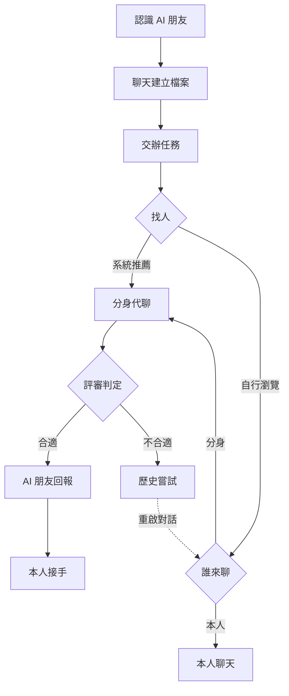

# PersonaAI｜06 終極精簡版

> 文件：[01 背景與競品](01_背景與競品.md) ｜ [02 核心邏輯與功能](02_核心邏輯與功能.md) ｜ [03 分工、進度與優先級](03_分工進度與優先級.md) ｜ [04 技術架構](04_技術架構.md) ｜ [05 評分導向功能補強](05_評分導向功能補強.md) ｜ **06 終極精簡版** ｜ [07 開發分工](07_開發分工.md)

> **AI 朋友認識你，社交 Agent 替你找到合得來的人。**

---

## 1. 核心功能

1. **AI 朋友**：有自己個性和虛構生活的 AI，陪你聊天，也在聊天中慢慢認識你。
2. **用戶檔案與記憶**：記下你主動分享的事，整理出你的性格與偏好，你可以查看、修改、刪除。
3. **分身**：只模仿你的說話風格，在你開啟後替你和別人聊天。
4. **一句話交辦任務**：說一句「幫我找 3 個喜歡登山的人」，Agent 會整理成任務，跟你確認後開始找人，達到你設的完成條件就停。
5. **找人目的**：除了交友，也能找讀書、運動、興趣同好，Agent 會依目的調整找人方式。
6. **系統推薦**：社交 Agent 自動在大廳挑人，派分身去聊。
7. **自行瀏覽大廳**：你自己逛用戶卡片挑人，再選本人聊或分身聊。
8. **大廳 AI 助手**：在大廳直接問「誰適合我」「A 和 B 誰比較好」，它幫你比較。
9. **分身 ↔ 分身快速代聊**：雙方的分身在 1–2 分鐘內聊完，產出判定結果和對話大綱。
10. **判定與檔位**：評審 Agent 判斷合不合適，你可以選單向合適或雙向合適才通知。
11. **AI 朋友回報**：代聊結果由 AI 朋友用朋友的口吻告訴你。
12. **本人接手**：隨時接手分身的對話，接手前先看前面的重點和分身說過的話。
13. **請求真人（轉人工）**：和對方分身聊天時可以請對方本人上線，對方選現在聊、稍後聊或拒絕。
14. **歷史嘗試與不合適原因**：每次代聊都留紀錄，說明沒成的原因，不合適的對話也能重啟。
15. **Agent 工作日誌（開發者開關）**：打開後即時顯示 Agent 每一步做了什麼、為什麼這樣做；一般用戶預設看不到。
16. **效率統計**：用代聊場數 × 人工平均聊天時間，算出幫你省下多少時間。
17. **異常處理**：模型出錯會重試，工具呼叫失敗就換下一位，對方離線就改成稍後聊。
18. **言行異常提醒**：對方本人的行為和他的描述極度不一致時，提醒你注意。
19. **隱私守門**：分身的每則訊息送出前都會檢查，避免洩漏你的隱私。
20. **娛樂性格話題**：MBTI、SBTI、性格報告只當聊天話題，不用來判斷合不合適。

---

## 2. Agent 智能體

1. AI 朋友 Agent
2. 社交 Agent
3. 分身 Agent
4. 評審 Agent
5. 隱私守門 Agent

---

## 3. 精簡流程圖

---

## 4. 未來規劃

1. 多位 AI 朋友
2. 關係成長與分享
3. 溝通情境練習
4. 外語朋友
