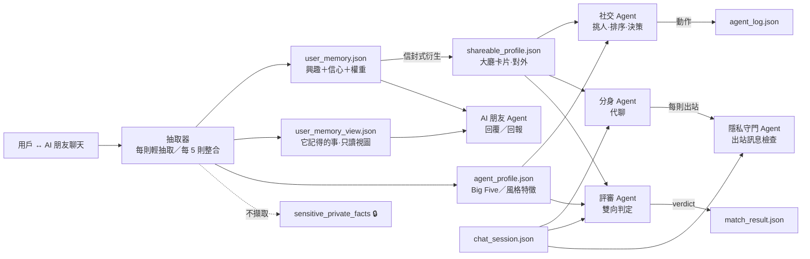

# PersonaAI｜09 Agent 數據結構（後端藍圖）

> 文件：[02 核心邏輯與功能](02_核心邏輯與功能.md) ｜ [04 技術架構](04_技術架構.md) ｜ **09 Agent 數據結構**
> 本文定義 5 個 Agent 在**無個體 context window** 前提下的全部狀態結構。記憶以 JSON 檔儲存（Supabase 亦可用 JSONB 欄位承載）。所有結構附範例值，後端與 AI 依此實作。

---

## 0. 前提：無個體 context window

5 個 Agent（AI 朋友、社交、分身、評審、隱私守門）**每次呼叫都是無狀態 LLM 請求**：不掛長駐對話歷史，不共享隱藏記憶。Agent 的全部認知來自 JSON 狀態檔，每次呼叫**只裝載該 Agent 最小必要的切片**：



**裝載規則（誰讀得到什麼）**

| Agent | 讀 | 絕不讀 |
|---|---|---|
| AI 朋友 | user_memory、user_memory_view、shareable_profile（回報用） | 對方的 agent_profile、對方的 user_memory |
| 社交 | agent_profile、shareable_profile（雙方）、task、match_result 歷史 | 原始聊天記錄（只讀大綱） |
| 分身 | shareable_profile（僅本方）、chat_session 當前對話、風格特徵 | user_memory 原文、Big Five |
| 評審 | chat_session、雙方 agent_profile、雙方 shareable_profile | user_memory 原文 |
| 隱私守門 | 當則出站訊息＋本方 shareable_profile 白名單 | 其他一切 |

---

## 1. 記憶結構 `user_memory.json`（核心）

興趣與偏好清單，每條帶**信心值與權重**。AI 朋友 Agent 是唯一寫入者。

```json
{
  "userId": "u_8821",
  "schemaVersion": 1,
  "updatedAt": 1761800000000,
  "items": [
    {
      "id": "mem_01",
      "topic": "hiking",
      "topicLabel": "登山",
      "value": "常去郊山，偏好半天內來回的路線",
      "confidence": 0.72,
      "weight": 0.8,
      "userLocked": false,
      "evidence": [
        { "at": 1761600000000, "sessionId": "fs_11", "kind": "self-report" },
        { "at": 1761700000000, "sessionId": "fs_12", "kind": "self-report" }
      ],
      "lastActiveAt": 1761700000000,
      "status": "active"
    },
    {
      "id": "mem_02",
      "topic": "reading",
      "topicLabel": "閱讀",
      "value": "偏好科普與輕小說，讀得慢",
      "confidence": 0.45,
      "weight": 0.5,
      "userLocked": false,
      "evidence": [{ "at": 1761750000000, "sessionId": "fs_12", "kind": "inferred" }],
      "lastActiveAt": 1761750000000,
      "status": "active"
    }
  ]
}
```

### 欄位語義

| 欄位 | 型別 | 說明 |
|---|---|---|
| `topic` | string | 標準化興趣代號（枚舉清單由後台維護：hiking/reading/gaming/…） |
| `topicLabel` | string | 顯示用中文標籤 |
| `value` | string | 具體內容描述（給 Agent 讀的一句話） |
| `confidence` | 0–1 | **信心值**：AI 對「用戶有這個興趣」多確定 |
| `weight` | 0–1 | **權重**：這個特質對「配對」的重要性 |
| `userLocked` | bool | 預留：用戶手動釘選/鎖定。MVP 全部 false，AI 自動維護 |
| `evidence[]` | array | 證據指標（時間＋會話＋來源分類），**不存聊天原文** |
| `evidence[].kind` | enum | `self-report`（用戶主動說）/ `inferred`（AI 從回應推斷）/ `task-usage`（在交辦任務中用過） |
| `status` | enum | `active` / `archived`（用戶「這不太像我」→ 歸檔不刪，供 AI 觀察） |

### 信心值規則（寫死）

1. **新記憶 0.3 起步**：單次提及只當話題線索（02 原則 5）。
2. **累積**：每多一次 `self-report` +0.15；`inferred` +0.05；跨不同會話出現再 +0.1。
3. **上限 0.95**：AI 永遠不對人下完全確定的結論。
4. **矛盾衰減**：出現反證（說不喜歡戶外）單次 −0.25，跌破 0.15 歸檔。
5. **時間衰減**：`lastActiveAt` 超過 60 天未被提及，每 30 天 −0.05（興趣會變）。

### 權重規則

1. **基準 0.5**：新記憶一律中位數，不預設重要。
2. **上調**：提及頻率（近 30 天內 ≥3 次提及 → +0.2）；被用於交辦任務條件（如「找喜歡登山的人」→ 該項 +0.3，`evidence` 追加 `task-usage`）。
3. **下調**：用戶在「它記得的事」裡反饋「這不太像我」→ weight 直接降 0.1 並 `status: archived`。
4. **上限 1.0**：weight 反映用戶在意程度，可以到頂。
5. `userLocked: true` 時 AI 不得變動 confidence/weight（MVP 未啟用）。

### 更新節奏（已確認方案）

- **每則用戶訊息**：輕量抽取 — 只產生「候選新記憶」（0.3 信心），不做重算。
- **每 5 則用戶回覆**：跑一次整合 — 套用上述累積/衰減規則、重算 weight、判斷是否觸發對外檔案重生成。
- **會話結束**：再跑一次整合＋時間衰減結算。

---

## 2. 用戶可視結構 `user_memory_view.json`

「它記得的事」頁面渲染用。從 user_memory 衍生的**只讀視圖**（衍生計算在寫入時完成，讀取零成本）：

```json
{
  "userId": "u_8821",
  "generatedAt": 1761800000000,
  "items": [
    {
      "memoryId": "mem_01",
      "display": "你常去登山，偏好半天來回的路線",
      "confidenceLabel": "還挺確定",
      "whyKnown": "你自己提過 2 次",
      "sortableWeight": 0.8
    },
    {
      "memoryId": "mem_02",
      "display": "你在讀科普和輕小說",
      "confidenceLabel": "初步印象",
      "whyKnown": "從聊天感覺到的",
      "sortableWeight": 0.5
    }
  ]
}
```

| 欄位 | 說明 |
|---|---|
| `display` | 給用戶看的一句話（不是內部 value 原文） |
| `confidenceLabel` | 離散化標籤：`初步印象`（<0.5）/ `還挺確定`（0.5–0.79）/ `很確定`（≥0.8）— **不顯示數字** |
| `whyKnown` | 來源說明（對應 evidence kind 的中文） |
| `sortableWeight` | 後端排序用（weight 降序），不顯示 |

**用戶動作**：刪除（→ user_memory 硬刪，02 原則 4）、「這不太像我」（→ 歸檔＋降權，見上節）。
**共享**：此視圖也注入 AI 朋友的提示詞 — 它必須知道「用戶看到過我記得什麼」，避免說出用戶已刪的事。

---

## 3. 對外檔案 `shareable_profile.json`（大廳卡片）

由 AI 朋友從 user_memory **衍生生成**並存儲；記憶變化觸發 `regenerate` 寫回。

```json
{
  "userId": "u_8821",
  "schemaVersion": 1,
  "userConfirmed": true,
  "confirmedAt": 1761750000000,
  "envelope": {
    "allowedTopics": ["hiking", "reading"],
    "styleAnchors": ["中短句為主", "溫和、偶爾冷幽默", "少量 emoji"]
  },
  "card": {
    "intro": "週末不是在山上就是在找下一條步道，也想找讀書搭子。",
    "interests": ["登山（郊山派）", "科普書", "輕小說"],
    "chatStyle": "慢熱但聊得深，喜歡追問細節",
    "recentStatus": "在計畫下個月的兩天一夜行程"
  },
  "derivedFrom": ["mem_01", "mem_02"],
  "regenPolicy": "envelope",
  "updatedAt": 1761800000000
}
```

### 信封式更新（已確認方案）

首次生成後需**用戶整體確認**（`userConfirmed: true`）才對外。之後：

| 變化 | 處理 | 用戶感知 |
|---|---|---|
| 既有興趣內微調（文字、排序、近況更新） | AI 直接改 `card`，自動生效 | 無感（信封內自由） |
| **全新興趣**（envelope 外 topic） | 卡片不動，進待確認佇列 | 下次見到「有新的想加」提示 |
| 風格錨點變化（styleAnchors 外的新風格） | 同上，需重新確認 | 同上 |
| 記憶刪除/歸檔 | 對應興趣從卡片移除（在下一次整合批次） | 無感 |

- `derivedFrom` 溯源：卡片上每個興趣都能對回記憶條目，刪記憶時知道該抽掉什麼。
- 隱私底線：卡片**永遠不含** evidence 原文、confidence 數值、Big Five（02 §7.1 的 shareable_profile 層定義）。

---

## 4. 其餘狀態檔（各 Agent 的輸入輸出）

### 4.1 `agent_profile.json`（後台計算用，不對外）

```json
{
  "userId": "u_8821",
  "bigFive": { "openness": 0.72, "conscientiousness": 0.55, "extraversion": 0.35, "agreeableness": 0.68, "stability": 0.60 },
  "confidence": { "openness": 0.8, "conscientiousness": 0.4, "extraversion": 0.7, "agreeableness": 0.6, "stability": 0.45 },
  "styleTraits": { "avgSentence": "short", "emojiRate": "low", "tone": "warm-dry", "formality": "casual" },
  "updatedAt": 1761800000000
}
```

社交/評審 Agent 用（靜態相容分數、判定指標權重）；每個維度獨立 confidence（低信心維度在配對時計分打折扣，02 §6.3）。

### 4.2 `task.json`（一句話交辦的結構化任務，02 §F12）

```json
{
  "id": "task_07",
  "userId": "u_8821",
  "goal": "運動夥伴",
  "condition": "喜歡登山",
  "conditionTopic": "hiking",
  "count": 3,
  "doneWhen": { "type": "mutual-fit", "n": 2 },
  "dailyChatsCap": 10,
  "status": "running",
  "progress": 1,
  "createdAt": 1761750000000
}
```

`conditionTopic` 連回 user_memory 的 topic 枚舉 — 這是 weight 上調的觸發源。

### 4.3 `chat_session.json`（分身代聊的當前狀態）

```json
{
  "id": "cs_31",
  "taskId": "task_07",
  "a": { "userId": "u_8821", "mode": "twin" },
  "b": { "userId": "u_9502", "mode": "twin" },
  "messages": [{ "round": 7, "speaker": "a-twin", "text": "看你常去登山，有沒有推薦的入門路線？", "privacyRewrite": false, "at": 1761800000000 }],
  "verdicts": [{ "round": 7, "aToB": 84, "bToA": 80, "consistent": 3 }],
  "status": "running"
}
```

### 4.4 `match_result.json`（結果頁與歷史，02 §F5/F8）

```json
{
  "id": "mr_12",
  "sessionId": "cs_31",
  "taskId": "task_07",
  "result": "mutual",
  "myView": {
    "score": 84,
    "trend": ["up", "up", "flat"],
    "fitPoints": [{ "text": "你也偏好慢熱的聊天節奏", "round": 4 }],
    "outline": { "topics": ["登山入門", "書", "週末行程"], "frictionPoints": [], "highlights": ["對方追問細節的方式讓對話有來有回"] }
  },
  "reasonType": "match",
  "initiated": "auto",
  "startedAt": 1761800000000
}
```

**注意**：`myView` 是各視角獨立存儲 — 我方存我的視角，對方存他的（`theirView` 只在對方資料庫，我方不可見，02 §F5）。

### 4.5 `agent_log.json`（工作日誌，開發者面板）

```json
{
  "entries": [
    { "id": "log_1", "at": 1761800000000, "role": "social", "text": "搜尋大廳：喜歡戶外、個性偏安靜 → 找到 5 位", "reason": "你偏好慢熱的人" },
    { "id": "log_2", "at": 1761800060000, "role": "judge", "text": "第 8 輪：你的視角合適、對方視角合適", "reason": "3 次判定一致" }
  ]
}
```

`role` 枚舉：`friend` / `social` / `twin` / `judge` / `privacy`（五個 Agent，每筆必附 `reason`）。

---

## 5. 五個 Agent 的呼叫契約

每次呼叫 = 系統提示詞（人格/職責）＋ JSON 切片注入＋本次輸入。

| Agent | 觸發時機 | 注入的 JSON | 輸出動作（寫入哪個檔） |
|---|---|---|---|
| **AI 朋友** | 用戶每則訊息 | user_memory + user_memory_view + 對方暱稱 | 回覆文本；（每 5 則）更新 user_memory；觸發 shareable_profile 重生成 |
| **社交** | 任務進行中每輪規劃 | task + agent_profile（雙方）+ 大廳 shareable_profile 清單 + match_result 歷史摘要 | 挑人決策（chat_session 建立）、agent_log、通知 |
| **分身** | 代聊每輪 | shareable_profile（僅本方）+ chat_session 當前對話 + 風格特徵 | 出站訊息（先過隱私守門） |
| **評審** | 每 N 輪（預設 5） | chat_session + 雙方 agent_profile + 雙方 shareable_profile | chat_session.verdicts 追加、（完成時）match_result |
| **隱私守門** | 分身每則出站前 | 該則訊息 + 本方 shareable_profile 白名單 | 放行 / 改寫（`privacyRewrite: true`）/ 擋下 |

抽取器（更新 user_memory 的那步）掛在 AI 朋友呼叫的輸出側，屬於朋友 Agent 的整合職責，不算第六個 Agent。

---

## 6. 已確認的設計決定

| 決定 | 內容 |
|---|---|
| 對外檔案更新 | **信封式**：首次整體確認後，既有興趣內 AI 自由微調；新興趣/新風格錨點需再確認 |
| weight 來源 | **AI 自動推導**（提及頻率＋任務使用），`userLocked` 欄位預留未啟用 |
| 更新節奏 | 每則輕抽取＋每 5 則用戶回覆整合＋會話結算 |
| 一致性 | 所有結構以 `schemaVersion` 開頭，改版遷移往後相容 |
